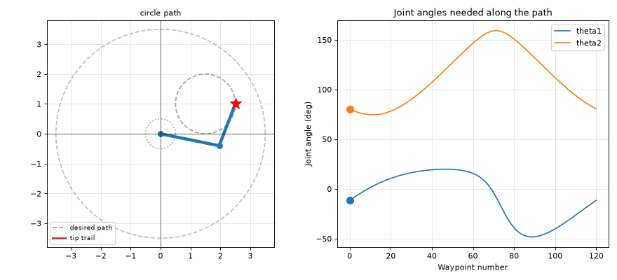
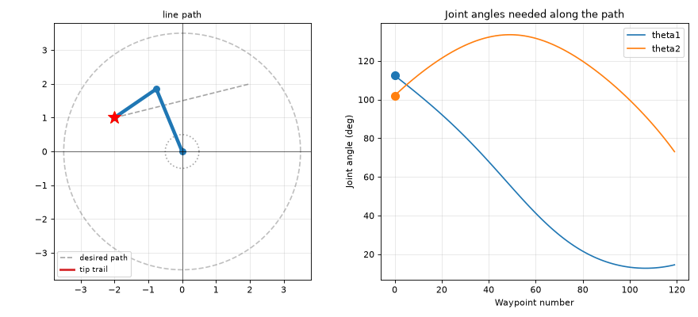
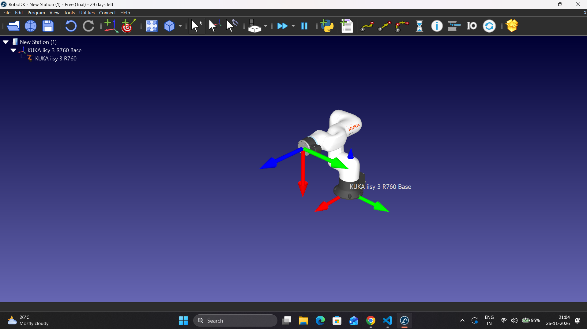
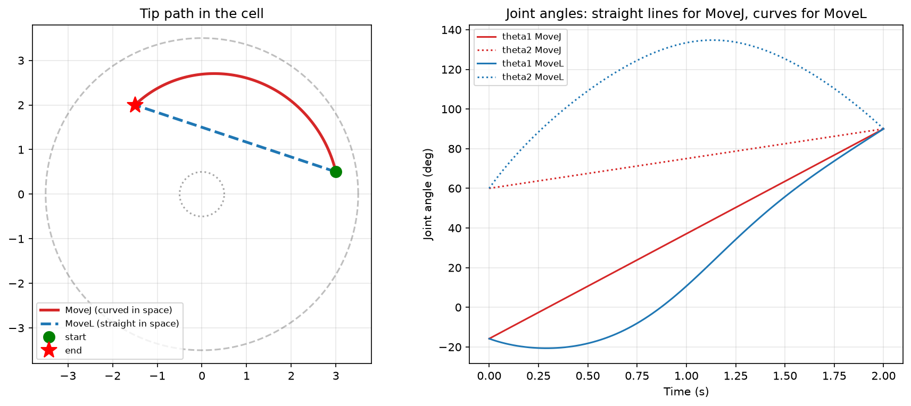

# Robotics to Physical AI: 26-Week Engineering Journey

[](https://github.com/Karthicknaruto/robotics-journey/actions/workflows/python-tests.yml)


> **Transitioning from Mechanical CAD & BiW Fixture Design into Robotics Simulation, Offline Programming (OLP), Motion Planning, and Physical AI.**  
> **Author:** Karthick Kumar S (Mechanical Engineer & Robotics Developer)  
> **Focus:** First-principles kinematics, industrial robot cell design, and autonomous physical systems.

---

## 📽️ Project Highlights & Visual Simulations

| Cartesian Circle Trajectory Following (120 Waypoints) | Linear Seam Trajectory Following (Zero Snapping) |
| :---: | :---: |
|  |  |
| *Discretized circle with closed-form IK ($8.46 \times 10^{-16}\text{ m}$ tracking error)* | *Straight-line Cartesian interpolation with joint angle unwrapping (`np.unwrap`)* |

| RoboDK Industrial Station Setup (ABB IRB 1600) | Joint Move (`MoveJ`) vs Linear Move (`MoveL`) |
| :---: | :---: |
|  |  |
| *3D industrial station with base reference frames, fixtures, and calibrated TCP* | *Comparison of non-linear C-space joint paths vs linear Cartesian tool paths* |

---

## 📊 Benchmarks & Verified Engineering Metrics

All mathematical models are validated with automated unit tests:

| Metric | Measured Value | Validation Method |
| :--- | :--- | :--- |
| **Round-Trip IK $\to$ FK Error** | **$9.93 \times 10^{-16}\text{ m}$** (Max) / **$2.74 \times 10^{-16}\text{ m}$** (Mean) | Double-precision machine epsilon verification over 200 solutions |
| **Workspace Annular Area** | **$37.70\text{ m}^2$** ($r_{\min} = 0.5\text{ m}, r_{\max} = 3.5\text{ m}$) | Verified against 20,000 Monte Carlo uniform random samples |
| **Boundary Classification Accuracy** | **100%** (355 Solved, 645 Rejected, **0 False Positives**) | 1,000 wide random points tested against analytical reach envelope |
| **Circle Path Tracking Error** | **$7.02 \times 10^{-16}\text{ m}$** | Trajectory verification across 120 closed-loop waypoints |
| **Joint Step Velocity Monitoring** | **$\le 4.00^\circ/\text{frame}$** | Singularity speed-spike avoidance for motor gear safety |
| **Automated Test Suite** | **138 Tests Passing** | Continuous Integration running across Python 3.11 & 3.12 |

---

## 🏗️ Repository Architecture & Directory Structure

```
robotics-journey/
├── .github/workflows/       # Automated CI (runs 138 pytest unit tests on every push)
├── month2/                  # Month 2: Modern Robotics & RoboDK Simulation (Days 29–33)
│   ├── day29_dof.py         # Grübler's formula / Kutzbach DoF calculator
│   ├── day30_mechanisms.py  # 4-bar, 6-axis, and Delta robot mechanism analysis
│   ├── day31_se3.py         # Lie Groups: SO(3) rotations & SE(3) 4x4 rigid transforms
│   ├── day32_robodk_check.py# RoboDK station initialization & robot library loading
│   ├── day33_make_program.py# Automated robot program generation (MoveJ / MoveL)
│   ├── day33_movej_vs_movel.py # Kinematic comparison of C-space vs Task-space paths
│   └── test_day*.py         # Unit test suites for Month 2 modules
├── week4/                   # Month 1 Milestone: Project 1 (2-Link Arm Kinematics Engine)
│   ├── day22_ik_theory/     # Closed-form analytical Inverse Kinematics (Law of Cosines)
│   ├── day23_ik_module/     # Robust IK module with UnreachableError boundary guards
│   ├── day24_ik_verification/ # Round-trip mathematical verification (100 targets)
│   ├── day26_ik_animation/  # Trajectory animation generation (GIF and PNG)
│   └── day27_project1/      # Project 1 complete package (`arm2link`)
│       └── project1_2link_arm/
│           ├── arm2link/    # Production-grade kinematics library
│           ├── tests/       # 46 test cases for kinematics and paths
│           └── run_all.py   # Master script to regenerate all plots and summaries
├── week3/                   # Month 1: Transformation Matrices & Forward Kinematics
│   ├── day20_fk_transforms/# Forward kinematics using 4x4 matrix chains (T1 @ T2)
│   └── day21_nlink_pytest/  # Generalized N-link planar arm forward kinematics
├── week1/                   # Month 1: Python OOP & Vector Foundations (Days 1–17)
│   └── day03_collections/   # Vector drills, 3D rotations, dot/cross products
├── results/                 # High-resolution output plots, GIFs, and summary reports
├── requirements.txt         # Pinned production dependencies
└── station.png              # RoboDK station configuration
```

---

## 📐 Mathematical Foundations

### 1. Forward Kinematics (Transform Chains)
For a multi-link serial arm, the position of the tool tip is determined by chaining homogeneous transformation matrices $T \in SE(3)$:
$$T_{\text{tip}} = T_{01}(\theta_1, L_1) \cdot T_{12}(\theta_2, L_2) \cdots T_{(n-1)n}(\theta_n, L_n)$$
$$T_i(\theta_i, L_i) = \begin{bmatrix} \cos\theta_i & -\sin\theta_i & 0 & L_i\cos\theta_i \\ \sin\theta_i & \cos\theta_i & 0 & L_i\sin\theta_i \\ 0 & 0 & 1 & 0 \\ 0 & 0 & 0 & 1 \end{bmatrix}$$

### 2. Closed-Form Inverse Kinematics (Law of Cosines)
Given target $(x, y)$, the elbow angle $\theta_2$ and shoulder angle $\theta_1$ are analytically resolved:
$$\cos\theta_2 = \frac{x^2 + y^2 - L_1^2 - L_2^2}{2 L_1 L_2}$$
$$\theta_2 = \pm \arccos(\cos\theta_2) \quad \implies \text{Elbow-Down } (+) \text{ vs. Elbow-Up } (-)$$
$$\theta_1 = \operatorname{atan2}(y, x) - \operatorname{atan2}(L_2 \sin\theta_2, L_1 + L_2 \cos\theta_2)$$

### 3. Degrees of Freedom (Grübler's Formula)
$$\text{DoF} = m(N - 1 - J) + \sum_{i=1}^J f_i$$
* **Planar 4-Bar Linkage ($m=3$):** $3(4 - 1 - 4) + 4(1) = \mathbf{1\text{ DoF}}$
* **6-Axis Spatial Robot ($m=6$):** $6(7 - 1 - 6) + 6(1) = \mathbf{6\text{ DoF}}$

---

## ⚡ Quickstart & How to Run

### 1. Clone & Set Up Virtual Environment
```bash
# Clone the repository
git clone https://github.com/Karthicknaruto/robotics-journey.git
cd robotics-journey

# Create and activate virtual environment
python -m venv .venv
source .venv/bin/activate       # On Linux/macOS
# .venv\Scripts\Activate.ps1    # On Windows PowerShell

# Install dependencies
pip install -r requirements.txt
```

### 2. Run the Full Test Suite (138 Unit Tests)
```bash
pytest -v
```

### 3. Regenerate Project 1 Kinematics Results & Animations
```bash
cd week4/day27_project1/project1_2link_arm
python run_all.py
```

### 4. Run Month 2 RoboDK Program Generator
```bash
python month2/day33_make_program.py
python month2/day33_movej_vs_movel.py
```

---

## 🗺️ 26-Week Master Roadmap Overview

- [x] **Month 1 (Weeks 1–4):** Python Foundations, Vector Math, 2-Link FK/IK, Trajectory Tracking (*Project 1 Completed* ✅)
- [ ] **Month 2 (Weeks 5–8):** Modern Robotics, DH Parameters, RoboDK Cell Design, Fixture Reach Studies (*In Progress - Day 33* 🟡)
- [ ] **Month 3 (Weeks 9–12):** ROS 2 Core (Jazzy), Nodes, Topics, Services, URDF & Gazebo Harmonic (*Pending* ⏳)
- [ ] **Month 4 (Weeks 13–16):** MoveIt 2 Motion Planning, PID Controllers & OpenCV Perception (*Pending* ⏳)
- [ ] **Month 5 (Weeks 17–20):** Deep Learning, PyTorch, YOLO Object Detection for Visual Picking (*Pending* ⏳)
- [ ] **Month 6 (Weeks 21–26):** Physical AI, Reinforcement Learning, MuJoCo & NVIDIA Isaac Sim (*Pending* ⏳)

---

## 👤 Author & Background

**Karthick Kumar S**  
* Graduate Engineer Trainee at PRANITRA Private Limited
* Specialized in Mechanical CAD, Body-in-White (BiW) Fixture Design, and Kinematic Automation
* Academic Background: Diploma in Mechanical Engg (2020–2023) | B.E. Mechanical Engg (2023–2026) | M.E. CAD/CAM (Ongoing)
* Collegiate Design Lead: SAE eBAJA (2024–2025)

Connect on [LinkedIn](https://linkedin.com) • [GitHub Profile](https://github.com/Karthicknaruto)

---
*License: [MIT](LICENSE)*
