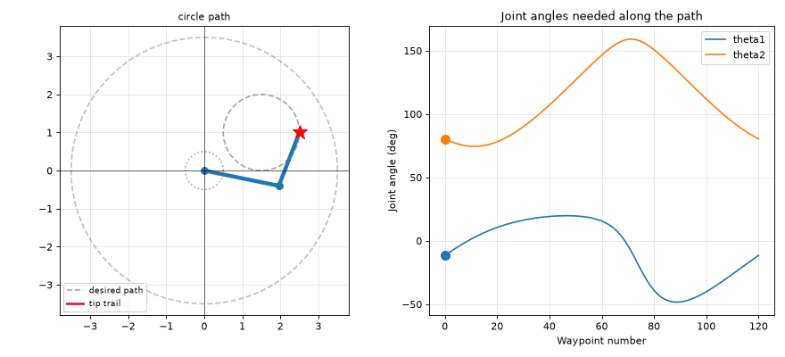
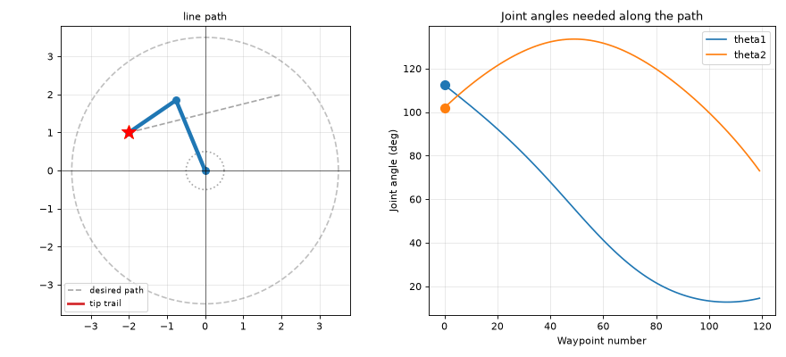
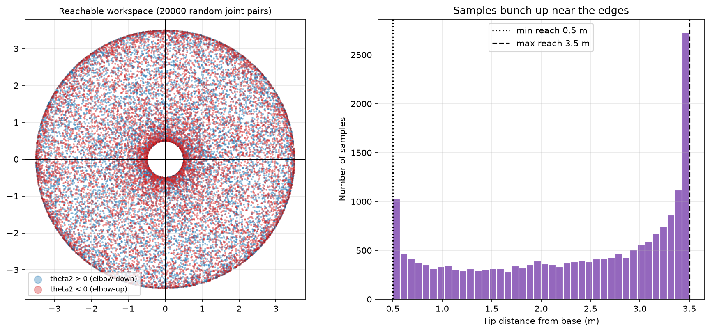
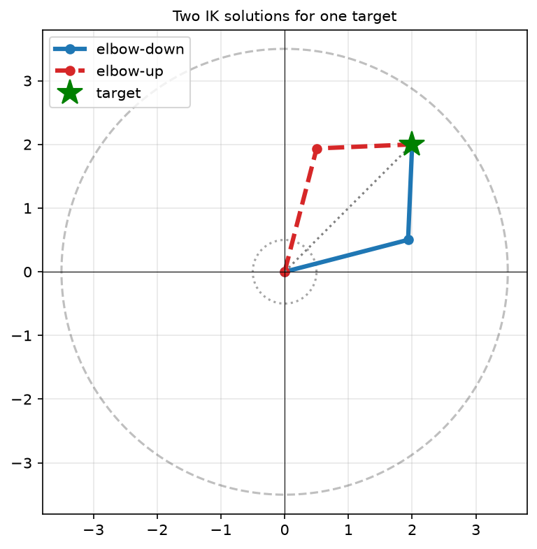
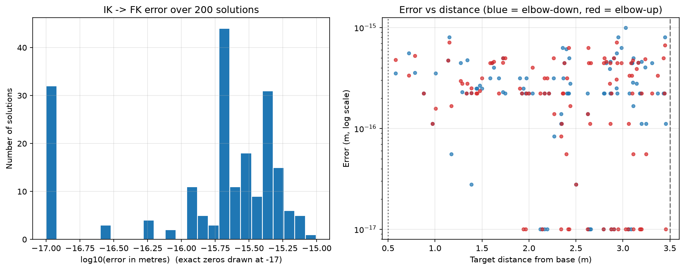

# Project 1: 2-Link Planar Robot Arm (FK, IK, Path Following)

A small Python package that models a 2-link robot arm. It computes forward kinematics (joint angles to tip position), inverse kinematics (tip position to joint angles), checks itself, maps the reachable workspace and animates the arm drawing a circle and a line.




## What it does
- **Forward kinematics (FK):** two independent methods, a transform chain and a closed-form formula. Tests check that they agree.
- **Inverse kinematics (IK):** closed-form solution with both elbow-down and elbow-up answers.
- **Error handling:** targets outside the reach ring raise `UnreachableError` with a clear message.
- **Path following:** IK at every waypoint of a circle or a line, with the tracking error measured.
- **Workspace:** random joint angles show where the tip can go.

## Project structure
```
project1_2link_arm/
  arm2link/
    transforms.py   rotation and 4x4 transform helpers
    kinematics.py   TwoLinkArm: fk, ik, is_reachable, nearest_reachable
    paths.py        circle_path, line_path, solve_path, tracking_error
    workspace.py    sample_workspace, workspace_summary
    verify.py       IK -> FK round-trip verification
    plotting.py     figures and GIF animations
  tests/            46 pytest tests
  run_all.py        regenerates everything in results/
  requirements.txt
```

## The math
Arm: link lengths L1 and L2, joint angles t1 (from the x-axis) and t2 (relative to link 1).

- FK: `x = L1 cos(t1) + L2 cos(t1 + t2)`, `y = L1 sin(t1) + L2 sin(t1 + t2)`
- IK: `cos(t2) = (x^2 + y^2 - L1^2 - L2^2) / (2 L1 L2)`, `t2 = +/- arccos(...)`,
  `t1 = atan2(y, x) - atan2(L2 sin(t2), L1 + L2 cos(t2))`
- Reachable when `|L1 - L2| <= sqrt(x^2 + y^2) <= L1 + L2`

## Results (L1 = 2.0 m, L2 = 1.5 m)
| Check | Result |
|---|---|
| IK -> FK max error (200 solutions) | 9.93e-16 m |
| IK -> FK mean error | 2.74e-16 m |
| 1000 random points, solved / rejected | 355 / 645 |
| Wrongly accepted / wrongly rejected | 0 / 0 |
| Reach ring | 0.5 m to 3.5 m |
| Workspace area | 37.70 m^2 |
| Circle path max tracking error | 7.02e-16 m |
| Line path max tracking error | 8.95e-16 m |
| Biggest joint step (circle / line) | 4.00 / 1.66 degrees per frame |
| Automated tests | 46 passed |

### Workspace


### Two IK solutions for one target


### Verification


## How to run
```powershell
python -m venv .venv
.venv\Scripts\Activate.ps1
pip install -r requirements.txt
python -m pytest -v
python run_all.py
```

## Limitations
- 2D only, two joints, no joint limits.
- No collision checking and no speed or acceleration limits.
- Every path point is solved independently. A straight line in space is not a straight line in joint space.
- The tracking error is numerical rounding, not real-robot accuracy.

## Next steps
Joint limits, a 3-link arm, numerical IK (Jacobian), then a URDF version for ROS2.
